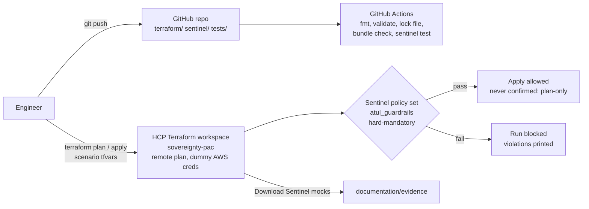

# Policy-as-Code for Irish Digital Sovereignty and IaC Supply Chain Security

Terraform and HashiCorp Sentinel, enforced in HCP Terraform Free, for organisation **ATUL0012345** (HCP organisation `ATUL00206134`).

Each Terraform plan for AWS is checked by Sentinel **after it is planned and before it can be applied**. A plan that would place sensitive data outside Ireland, open SSH to the internet, run an unencrypted volume, allow IMDSv1, use an unapproved instance type, or pull a provider or module from an untrusted source is blocked. Nothing in this project is ever applied: the HCP workspace only holds dummy AWS credentials, so even an approved plan cannot create real resources.

## Contents

1. [Context](#1-context)
2. [Architecture](#2-architecture)
3. [Repository layout](#3-repository-layout)
4. [Policies](#4-policies)
5. [How enforcement prevents non-compliant deployments](#5-how-enforcement-prevents-non-compliant-deployments)
6. [Evidence](#6-evidence)
7. [How to run it](#7-how-to-run-it)
8. [Design justification](#8-design-justification)
9. [Supply chain risks Sentinel cannot address](#9-supply-chain-risks-sentinel-cannot-address)
10. [Design decisions and trade-offs](#10-design-decisions-and-trade-offs)
11. [Use of AI tools](#11-use-of-ai-tools)
12. [References](#12-references)

## 1. Context

Irish authorities signed the Declaration for European Digital Sovereignty in November 2025. The Republic of Ireland will hold the presidency of the Council of the EU from 01-Jul through to 31-Dec 2026. Digital security and digital resilience will be among the priorities of the Irish presidency. It is therefore the responsibility of the individual as head of IT at ATUL00206134 to take the commitments made by Irish authorities to create control flows (i.e., controls) that automatically execute each time an infrastructure change is made -- instead of creating a control flow that requires individuals to rely on their memories of what has been committed to.

There are three categories of control being created:

- **Digital sovereignty** - approved geographic regions; residency of sensitive information/data; location(s) for replication and back-up; potential source(s) of administrative access.
- **Security within IaC supply chains**: approved providers/sources; trusted/pinned modules/versions; locked-down Terraform versions; lock-files/CICD controls using tools such as Sentinel which can operate independently from other tooling.
- **Infrastructure Security**: approved EC2 instance types; encrypted EBS volumes; mandatory use of IMDSv2; and network-based rules (e.g., restricted/limited use of SSH

## 2. Architecture



The repository is the source of truth. GitHub Actions re-checks formatting, provider lock integrity and every Sentinel test case on each push. Real plans run in HCP Terraform, where the policy set sits between plan and apply.

## 3. Repository layout

```
README.md
.github/workflows/terraform-checks.yml   CI: Terraform checks + Sentinel tests
terraform/
  versions.tf  cloud.tf  providers.tf  variables.tf  main.tf  network.tf
  modules/secure_bucket/                 local (trusted) module
  scenarios/*.tfvars                     compliant and non-compliant inputs
  .terraform.lock.hcl                    pinned provider versions and checksums
  tfplan, tfplan.txt, tfplan.json        saved plan of the compliant scenario
sentinel/
  sovereignty.sentinel  supply_chain.sentinel  encryption.sentinel
  metadata.sentinel     network.sentinel       instance_type.sentinel
  sentinel.hcl                            intended enforcement levels
  hcp/atul_guardrails.sentinel            generated bundle deployed to HCP Free
  hcp/sentinel.hcl
tests/
  test-scenarios.md                       what each scenario and test proves
  testdata/                               tfplan/v2 and tfconfig/v2 mocks
  <policy>/pass.hcl, fail.hcl             one folder per policy + the bundle
scripts/
  bundle_sentinel.py                      builds and checks the HCP bundle
  run-sentinel-tests.sh                   runs all Sentinel tests
documentation/
  evidence/                               screenshots, outputs, HCP mocks
  technical-report/                       one-page report (LaTeX + PDF)
  llm-declaration.md                      AI tool use and prompt
```

## 4. Policies

| Policy | Requirement from the brief | What it checks | Level (paid tier) | On HCP Free |
| --- | --- | --- | --- | --- |
| `sovereignty` | Approved regions; data residency; replication, backups | Every regional resource's own planned `region` is approved (eu-west-1, eu-central-1). Data-holding resources tagged `DataClassification = sensitive`, or untagged, are in eu-west-1 only. Backup copy targets are in eu-west-1. (Admin access from Irish networks only is checked by `network`.) | hard-mandatory | in bundle |
| `supply_chain` | Approved provider sources and versions; trusted, pinned modules | Provider `full_name` is `registry.terraform.io/hashicorp/aws` with version constraint `~> 6.0`. Terraform is 1.17.x. Modules are local, or from an approved registry namespace with an exact version. | hard-mandatory | in bundle |
| `encryption` | Encrypted EBS | Standalone volumes, instance root and extra block devices. An instance that does not declare its root device fails, because encryption cannot be proven. | hard-mandatory | in bundle |
| `metadata` | Mandatory IMDSv2 | `metadata_options.http_tokens = "required"` on instances. Not declaring it fails. | hard-mandatory | in bundle |
| `network` | Network security; no unrestricted SSH; admin access | Ingress only as `aws_vpc_security_group_ingress_rule`. SSH/RDP only from the approved Irish admin network. No all-traffic ingress from the internet, no public IPs on instances. | hard-mandatory | in bundle |
| `instance_type` | Approved EC2 instance types | `t3.micro`, `t3.small`, `t3.medium` on instances. | soft-mandatory | in bundle |

Design choices that close common bypasses:

- **Region per Resource (AWS Provider v6)**. As of version 6, any regional resource can now override the provider by defining its own "region." A policy that only reads the provider will approve an S3 Bucket for deployment in us-east-1. The following policy uses the provisioned region for every resource, and then uses supply chain to pin the provider to v6. This ensures that the attributes will always be available.

- **Fail Closed.** Any unknown values, missing tags, or undecleared blocks result in violations. There is no other way than failure when forgetting something in a plan.

- **One Way to Write Ingress.** Although AWS has three ways to express the same rule, Terraform allows only one: aws_vpc_security_group_ingress_rule. Inline ingress blocks and aws_security_group_rule will always be blocked and therefore cannot be used to bypass checks and allow unauthorized access via ssh.

- **Policies Outside of the Code They Govern.** Because variables do not contain a validation block for this very reason, anyone able to modify Terraform may also be able to modify these variables. Sentinel does run from Hashicorp Cloud Platform (HCP), which is outside of your engineers' control.

## 5. How enforcement prevents non-compliant deployments

An HCP Terraform Run proceeds through a number of predetermined steps: first a plan, then an evaluation against policy, then application. Sentinal will evaluate a plan prior to sending any API request which could result in new or changed infrastructure. The CLI will display sentinal results for all CLI driven runs.

For a run that is stopped due to failing a policy evaluation by being set to "hard-mandatory", no apply step will ever occur and cannot be overridden. When set to "soft-mandatory" a user with "override" permissions will still be able to proceed with the run but this action will also be recorded as part of the audit log. For "advisory" only warnings will occur.

The fact that the policy evaluates against the plan means that it prevents the creation of changes before they exist. Because a resource scanner has to scan existing resources (example: AWS Config), if the scanner finds a resource outside of the scope of what is allowed; the resource may have already been created, and data may already be out of the jurisdiction.

Defense in Depth for this project was achieved in such a way that there are multiple layers of defense. Even though a plan passes; the workspace contains only dummy credentials, therefore nothing can actually be applied.

## 6. Evidence

| Evidence | File |
| --- | --- |
| Policy set in HCP: one hard-mandatory policy `atul_guardrails` | `05-policy-set.png` |
| Free tier refuses a second mandatory policy | `06-free-tier-mandatory-limit.png` |
| Compliant plan: policy check passed | `01-compliant-pass.png`, `plan-compliant.txt` |
| Everything-wrong plan: blocked, all violations printed | `02-noncompliant-all-blocked.png`, `plan-noncompliant-all.txt` |
| Region moved to us-east-1: blocked | `03-noncompliant-region-blocked.png`, `plan-noncompliant-region.txt` |
| SSH open to the internet: blocked | `04-noncompliant-ssh-blocked.png`, `plan-noncompliant-ssh.txt` |
| Saved plan of the compliant scenario | `terraform/tfplan`, `terraform/tfplan.txt`, `terraform/tfplan.json` |
| Sentinel mocks downloaded from the HCP runs | `hcp-mocks/` |
| All Sentinel test cases (pass and fail) | `sentinel-test-output.txt`, summary in `test-results.md` |
| CI green on GitHub Actions | `07-github-actions-green.png` |

## 7. How to run it

Prerequisites: Terraform 1.17.x, Sentinel CLI 0.40.0 (checksum verified), Python 3, an HCP Terraform Free account.

**HCP Terraform (one-off):**

1. In HCP Europe (portal.cloud.eu.hashicorp.com), create organisation `ATUL00206134` and a **CLI-driven** workspace `sovereignty-pac` (execution mode Remote, Terraform 1.17.x, manual apply).
2. Add **environment variables** `AWS_ACCESS_KEY_ID` and `AWS_SECRET_ACCESS_KEY` with the dummy value `offline-plan-only`.
3. Create a policy set `atul-guardrails` (individually managed, Sentinel, enforced globally). Create one policy `atul_guardrails`, **hard-mandatory**, with the contents of `sentinel/hcp/atul_guardrails.sentinel`.

**Plans:**

```bash
terraform login app.eu.terraform.io # once: stores an HCP Europe API token locally
cd terraform
terraform init
cp scenarios/compliant.tfvars active.auto.tfvars
terraform apply                     # policy passes; answer "no"
cp scenarios/noncompliant-all.tfvars active.auto.tfvars
terraform apply                     # blocked by the hard-mandatory policy
```

`*.auto.tfvars` files are loaded automatically and uploaded with the configuration, so the remote run sees the scenario.

**Offline tests:**

```bash
bash scripts/run-sentinel-tests.sh          # every pass and fail case
python3 scripts/bundle_sentinel.py          # rebuild the HCP bundle after editing a policy
python3 scripts/bundle_sentinel.py --check  # what CI runs
```

## 8. Design justification


### 8.1 Policy as code and digital sovereignty

Policy as code creates a digital sovereignty commitment with a 'check' on every change (the same way each time), leaving a record. The policies, being version-controlled, reviewed peer-to-peer, and tested similarly to how application code is; therefore they are auditability. Enforcement is moved to the most cost-effective place; if a plan is blocked, then a few seconds of delay will occur; however, data that has already been replicated to another jurisdiction may be irretrievable.

The effectiveness of Policy as code is limited by coverage. Only changes made through Terraform in workspaces where the Policy set applies are governed. Other tools or console changes, and other accounts are outside the scope of this governance; therefore Policy as code should be used in conjunction with account level guard rails (section 10).

### 8.2 data residency controls and their limitations based upon regions

- **regions are not jurisdictions.** although EU-west-1 stores data in physical locations in Ireland, aws is a u.s.-based company. Therefore laws such as the u.s. Cloud act allow for the compelling of a u.s. Provider to provide data that the provider controls based upon where ever it is located. Region checks offer data residency, not full sovereignty. Options such as the AWS European Sovereign Cloud (available since January 2026, run separately within the EU) address this gap, and could be included as an approved region in their own partition. 
- **there is only one aws region in Ireland.** any requirement to store sensitive data in EU-west-1 precludes the ability to perform cross-regional disaster recovery for that data. However, regional resilience comes from using multiple Availability Zones within the region. This is a real trade-off between having your data in a sovereign country versus being able to maintain availability when needed. This decision was made deliberately. 
- **global services have no region.** IAM, Route 53 and CloudFront operate globally. A region Policy cannot restrict these types of services. 
- **data can be moved without making infrastructure changes.** an application can replicate data to another country via an API request, and a user can retrieve the information. A plan will never reflect this action. 
- **not all locations are available to view at plan time.** a raw arn for an S3 replication destination does not include a region, and values calculated during apply time are unknown. When determining whether an unknown region would fail closed on plans (which can cause legitimate plans to fail and require maintenance).

### 8.3 Why does integrity matter within the supply chain?

Third party code (modules/providers) is being executed by Terraform using high powered cloud credentials. If there is a malicious or compromised provider it will be able to read all of the secrets provided to it and create everything that its credentials allow. If you pull a module from an active branch then the module may have changed when the second run happens without any type of code review. When you use pinned versions/sources it takes "whichever version is available" and makes it "which version has been reviewed." The hash of the locked packages are checked for when a swap occurs.

The reason for sovereignty is direct, if there were a compromised provider it would be able to send your data/credentials wherever they wanted regardless of what you had specified for region settings.

### 8.4 What are the limitations of Sentinel and Plan Time Enforcement?

Plan Only: Sentinel sees what Terraform wants to do. However, it does NOT see how things currently are (drift), what things look like at runtime (console changes), etc...

Unknown Values: Any value calculated at apply time (such as IDs, ARNs, some regions) will be unknown at plan time. Therefore policies need to decide whether they want to fail closed (safer, more false positives) or fail open.

Only Terraform Managed & Only Covered Workspaces: Another tool or another workspace can bypass Sentinel.

Cannot View Binaries or Lock File: There is no way for Sentinel to confirm that the binary for the provider is legitimate (section 9).

Account Defaults Are Invisible: Account-wide defaults such as EBS encryption by default or IMDSv2 defaults set at the account level are not shown in a plan and must therefore be explicitly set.

Platform Limits: HCP Terraform Free only allows one policy set containing up to 5 policies, where only one of which must be mandatory. In addition, HCP Terraform Free only allows non-VCS connected policy sets. This means that the policy set within HCP is manually copied and paste into HCP and will likely become out of sync with the repository. While CI will verify that the policy bundle that was created from the source policies match the actual policies in the bundle, it will not verify that the policies in HCP match the policies in the bundle.

### 8.5 How do you maintain policies as cloud environments evolve?

As cloud providers continue to change their offerings faster than the development community continues to develop policies. This can result in issues. An example of this issue is seen in AWS Provider v6. By adding a per-resource 'region' attribute to make the provider support multiple regions silently resulted in all region-specific checks performed by provider-only region checks to be incomplete. Additional examples include new AWS services/resources that store data (these resources/data-types must be added to the data-type list), new regions/partitions within AWS, new instance families, updates to provider schemas that add/changing names of attributes and new rule formats such as newer security group rules.

To manage these changes we perform: Tests of every policy with both a pass/fail mock and test for CI; Pinned versions of providers/Terraform so that when you update your environment the changes are intentional/re-tested; Parameters (regions/types/CIDRs) are separated from logic; Failing Closed when encountering unknown types/values; Updating mocks for testing from actual HCP runs after every change/upgrades.

## 9. Supply chain risks Sentinel cannot address

| Risk | Why Sentinel cannot catch it | Control used or recommended |
| --- | --- | --- |
| Tampered provider binary | Sentinel sees configuration, not binaries | Committed `.terraform.lock.hcl` checksums; CI `terraform init -lockfile=readonly`; registry signature verification |
| Malicious release signed with a legitimate key | It is a "genuine" approved version | Exact version pinning, delayed adoption, Dependabot PRs with review |
| Bad code inside an approved, pinned module | Source and version look correct | Code review, prefer local or private-registry modules |
| Compromised CI or GitHub Actions | Outside Terraform entirely | Least-privilege `permissions`, pin actions to commit SHAs (recommended next step), branch protection |
| Policy edited in the HCP UI (Free tier) | The policy is the thing being changed | Bundle generated from reviewed source, CI drift check, audit log; paid tier VCS policy sets |
| Secrets in plans, state or mocks | Data handling, not configuration | Dummy credentials here; sensitive variables; restricted mock downloads |
| Compromised Terraform CLI or HCP itself | Sentinel runs inside it | Checksum-verified downloads, vendor trust |

## 10. Design decisions and trade-offs

| Decision | Chosen | Alternatives | Trade-off accepted |
| --- | --- | --- | --- |
| Enforcement on HCP Free | Six modular policies merged by `scripts/bundle_sentinel.py` into one hard-mandatory policy | Sovereignty mandatory, rest advisory; paid tier | HCP shows one policy (the printed output still names each violated rule); instance type loses its soft-mandatory override on Free |
| AWS credentials | Dummy credentials + provider skip flags | Real account with OIDC dynamic credentials | No AWS data sources (e.g. AMI lookup) at plan time |
| Region model | Sensitive data eu-west-1 only; other resources eu-west-1 or eu-central-1 | Ireland-only for all; any EU region | No cross-region DR for sensitive data |
| Workflow | CLI-driven workspace, scenario tfvars | VCS-driven workspace with PR checks | No automatic PR gate yet |
| Tests | Hand-written mocks covering bypasses, plus mocks downloaded from real runs as evidence | Downloaded mocks only | Hand-written mocks must track the real plan shape |

**Recommended next steps:** VCS-connected policy sets (paid tier) or the `tfe` provider to remove the manual paste; AWS Organizations service control policies denying non-approved regions as a runtime backstop; AWS Config rules for drift; OIDC dynamic credentials with a read-only role; Dependabot and commit-SHA pinning for GitHub Actions.

## 11. Use of AI tools

This project was built with help from **Claude Opus 5.5 (Anthropic)**, used through claude.ai on 22 and 23 November 2026. Claude acted as a tutor and drafted the Terraform configuration, Sentinel policies, mocks and tests, CI workflow, this README and the report outline. I set up HCP Terraform and GitHub, ran every plan and test, captured the evidence, and reviewed and corrected the generated code and documentation. The prompt and how the tool was used are recorded in [`documentation/llm-declaration.md`](documentation/llm-declaration.md).

## 12. References

- Department of Enterprise, Tourism and Employment (2025) *Ireland signs Declaration for European Digital Sovereignty*. https://enterprise.gov.ie/en/news-and-events/department-news/2025/november/20251118.html
- Council of the EU (2026) *Programme of the Irish Presidency of the Council of the European Union*. https://irish-presidency.consilium.europa.eu/en/programme/programme-of-the-irish-presidency
- HashiCorp (2026) *Manage policies and policy sets in HCP Terraform*. https://developer.hashicorp.com/terraform/cloud-docs/workspaces/policy-enforcement/manage-policy-sets
- HashiCorp (2026) *Generate mock Sentinel data with Terraform*. https://developer.hashicorp.com/terraform/cloud-docs/policy-enforcement/sentinel/mock
- HashiCorp (2026) *tfconfig/v2 import*. https://developer.hashicorp.com/terraform/cloud-docs/policy-enforcement/sentinel/import/tfconfig-v2
- HashiCorp (2025) *Terraform AWS provider 6.0 now generally available*. https://www.hashicorp.com/blog/terraform-aws-provider-6-0-now-generally-available
- Amazon Web Services (2026) *Opening the AWS European Sovereign Cloud*. https://aws.amazon.com/blogs/aws/opening-the-aws-european-sovereign-cloud
- mattias.engineer (2024) *Deep-Dive: HashiCorp Sentinel with Terraform* (HCP Free policy limits). https://mattias.engineer/blog/2024/hashicorp-sentinel-with-terraform/
