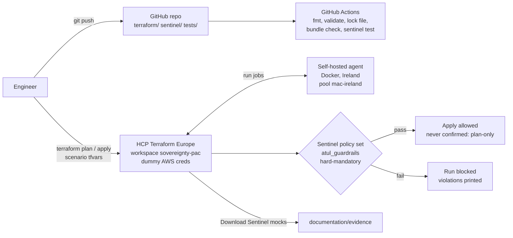

# Policy-as-Code for Irish Digital Sovereignty and IaC Supply Chain Security

Terraform and HashiCorp Sentinel, enforced in HCP Terraform Free, for organisation **ATUL0012345** (HCP organisation `ATUL00206134`).

Every Terraform plan for AWS is checked by Sentinel **after it is planned and before it can be applied**. A plan that would place sensitive data outside Ireland, open SSH to the internet, run an unencrypted volume, allow IMDSv1, use an unapproved instance type, or pull a provider or module from an untrusted source is blocked. Nothing in this project is ever applied: the HCP workspace only holds dummy AWS credentials, so even an approved plan cannot create real resources.

## Contents

1. [Context](#1-context)
2. [Architecture](#2-architecture)
3. [Repository layout](#3-repository-layout)
4. [Policies](#4-policies)
5. [How enforcement prevents non-compliant deployments](#5-how-enforcement-prevents-non-compliant-deployments)
6. [Evidence](#6-evidence)
7. [How to run it](#7-how-to-run-it)
8. [Design justification](#8-design-justification)
9. [Supply chain risks Sentinel cannot address](#9-supply-chain-risks-sentinel-cannot-address)
10. [Design decisions and trade-offs](#10-design-decisions-and-trade-offs)
11. [Use of AI tools](#11-use-of-ai-tools)
12. [References](#12-references)

## 1. Context

Ireland signed the Declaration for European Digital Sovereignty in November 2025, and holds the Presidency of the Council of the EU from 1 July to 31 December 2026, with digital security and resilience among its priorities. As head of IT for ATUL0012345, the goal is to turn those commitments into controls that run on every infrastructure change, rather than into a policy document that people are trusted to remember.

Three groups of controls are implemented:

- **Digital sovereignty:** approved regions, residency of sensitive data, replication and backup locations, and where administrative access may come from.
- **IaC supply chain security:** approved provider sources and versions, trusted and pinned modules, a pinned Terraform version, plus lock-file and CI controls outside Sentinel.
- **Infrastructure security:** approved EC2 instance types, encrypted EBS, mandatory IMDSv2, and network rules including no unrestricted SSH.

## 2. Architecture



The repository is the source of truth. GitHub Actions re-checks formatting, provider lock integrity and every Sentinel test case on each push. Real plans are run by HCP Terraform Europe on a self-hosted agent in Ireland, and the policy set sits between plan and apply.

## 3. Repository layout

```
README.md
.github/workflows/terraform-checks.yml   CI: Terraform checks + Sentinel tests
terraform/
  versions.tf  cloud.tf  providers.tf  variables.tf  main.tf  network.tf
  modules/secure_bucket/                 local (trusted) module
  scenarios/*.tfvars                     compliant and non-compliant inputs
  .terraform.lock.hcl                    pinned provider versions and checksums
  tfplan, tfplan.txt, tfplan.json        saved plan of the compliant scenario
sentinel/
  sovereignty.sentinel  supply_chain.sentinel  encryption.sentinel
  metadata.sentinel     network.sentinel       instance_type.sentinel
  sentinel.hcl                            intended enforcement levels
  hcp/atul_guardrails.sentinel            generated bundle deployed to HCP Free
  hcp/sentinel.hcl
tests/
  test-scenarios.md                       what each scenario and test proves
  testdata/                               tfplan/v2 and tfconfig/v2 mocks
  <policy>/pass.hcl, fail.hcl             one folder per policy + the bundle
scripts/
  bundle_sentinel.py                      builds and checks the HCP bundle
  run-sentinel-tests.sh                   runs all Sentinel tests
documentation/
  evidence/                               screenshots, outputs, HCP mocks
  L00206134_Ace_Perez_Technical_Report.pdf  one-page technical report
  llm-declaration.md                      AI tool use and prompt
```

## 4. Policies

| Policy | Requirement from the brief | What it checks | Level (paid tier) | On HCP Free |
| --- | --- | --- | --- | --- |
| `sovereignty` | Approved regions; data residency; replication, backups | Every regional resource's own planned `region` is approved (eu-west-1, eu-central-1). Data-holding resources tagged `DataClassification = sensitive`, or untagged, are in eu-west-1 only. Backup copy targets are in eu-west-1. (Admin access from Irish networks only is checked by `network`.) | hard-mandatory | in bundle |
| `supply_chain` | Approved provider sources and versions; trusted, pinned modules | Provider `full_name` is `registry.terraform.io/hashicorp/aws` with version constraint `~> 6.0`. Terraform is 1.17.x. Modules are local, or from an approved registry namespace with an exact version. | hard-mandatory | in bundle |
| `encryption` | Encrypted EBS | Standalone volumes, instance root and extra block devices. An instance that does not declare its root device fails, because encryption cannot be proven. | hard-mandatory | in bundle |
| `metadata` | Mandatory IMDSv2 | `metadata_options.http_tokens = "required"` on instances. Not declaring it fails. | hard-mandatory | in bundle |
| `network` | Network security; no unrestricted SSH; admin access | Ingress only as `aws_vpc_security_group_ingress_rule`. SSH/RDP only from the approved Irish admin network. No all-traffic ingress from the internet, no public IPs on instances. | hard-mandatory | in bundle |
| `instance_type` | Approved EC2 instance types | `t3.micro`, `t3.small`, `t3.medium` on instances. | soft-mandatory | in bundle |

Design choices that close common bypasses:

- **Per-resource region (AWS provider v6).** Since v6, any regional resource can set its own `region`, overriding the provider. A policy that only reads the provider block would approve an S3 bucket in us-east-1. This policy reads each resource's planned region, and `supply_chain` pins the provider to v6 so the attribute is always there.
- **Fail closed.** Unknown at plan time, missing tag, or undeclared block all count as violations. Forgetting something can only make a plan fail, never pass.
- **One way to write ingress.** AWS accepts three forms of the same rule. Only `aws_vpc_security_group_ingress_rule` is allowed; inline `ingress` blocks and `aws_security_group_rule` are rejected outright, so they cannot be used to sneak SSH past the checks.
- **Policy outside the code it governs.** Variables have no validation blocks on purpose: anyone who can edit the Terraform could edit those. Sentinel runs in HCP, outside the engineer's control.

## 5. How enforcement prevents non-compliant deployments

An HCP Terraform run moves through fixed stages: **plan, then policy check, then apply**. Sentinel evaluates the plan before any API call that would create or change infrastructure. HCP only evaluates policies on plans that succeed, and the CLI prints Sentinel results for CLI-driven runs.

With the policy set to **hard-mandatory**, a failed check ends the run: the apply stage is never offered and nobody can override it. With **soft-mandatory**, a user with the override permission may continue, and the override is recorded in the audit trail. **Advisory** only warns.

Because the policy reads the plan, it blocks the change **before it exists**. A scanner that checks deployed resources (for example AWS Config) can only report the problem afterwards, when data may already have left the jurisdiction.

Defence in depth in this project: even a passing plan cannot be applied, because the workspace holds only dummy credentials.

## 6. Evidence

| Evidence | File |
| --- | --- |
| Policy set in HCP: `atul-guardrails`, scope and attached policy | `01-policy-set.png` |
| Policy `atul_guardrails`: Sentinel, hard mandatory; HCP warns the Free tier's single mandatory policy is already used | `02-policy-hard-mandatory.png` |
| Compliant plan: policy check passed | `03-compliant-pass.png`, `plan-compliant.txt` |
| Everything-wrong plan: blocked, all violations printed | `04-noncompliant-all-blocked.png`, `05-noncompliant-all-violations.png`, `plan-noncompliant-all.txt` |
| Region moved to us-east-1: blocked | `06-noncompliant-region-blocked.png`, `plan-noncompliant-region.txt` |
| SSH open to the internet: blocked | `07-noncompliant-ssh-blocked.png`, `plan-noncompliant-ssh.txt` |
| Saved plan of the compliant scenario | `terraform/tfplan` (plan output), `terraform/tfplan.json` (machine-readable, what Sentinel reads), `terraform/tfplan.txt` (same as `tfplan`), `terraform/tfplan.hcp-run` (the saved-plan pointer `terraform plan -out` writes for HCP runs: it holds only the run ID) |
| Sentinel mocks downloaded from the HCP runs | `hcp-mocks/` |
| All Sentinel test cases (pass and fail) | `sentinel-test-output.txt`, summary in `test-results.md` |
| CI green on GitHub Actions | `08-github-actions-green.png` |

## 7. How to run it

Prerequisites: Terraform 1.17.x, Sentinel CLI 0.40.0 (checksum verified), Python 3, Docker, an HCP Europe account.

**HCP Terraform (one-off):**

1. In HCP Europe (portal.cloud.eu.hashicorp.com), create organisation `ATUL00206134` and a **CLI-driven** workspace `sovereignty-pac` (Terraform 1.17.x, manual apply).
2. Create an agent pool `mac-ireland` and an agent token, start the agent, then set the workspace's execution mode to **Agent** with that pool. HCP Europe's hosted runners errored every run for this organisation within a second of queueing, with no logs; a self-hosted agent runs the same job on your own machine while HCP still evaluates Sentinel:

   ```bash
   read -s "TFC_AGENT_TOKEN?Paste agent token: " && export TFC_AGENT_TOKEN   # zsh: hidden input, not saved in history
   docker run -d --name tfc-agent --platform linux/amd64 \
     -e TFC_ADDRESS=https://app.eu.terraform.io -e TFC_AGENT_TOKEN -e TFC_AGENT_NAME=ace-mac \
     hashicorp/tfc-agent:latest
   ```

   `linux/amd64` matches the `linux_amd64` checksums in `.terraform.lock.hcl`.
3. Add **environment variables** `AWS_ACCESS_KEY_ID` and `AWS_SECRET_ACCESS_KEY` (marked sensitive) with the dummy value `offline-plan-only`.
4. Create a policy set `atul-guardrails` (individually managed, Sentinel, enforced globally). Create one policy `atul_guardrails`, **hard-mandatory**, with the contents of `sentinel/hcp/atul_guardrails.sentinel`.

**Plans:**

```bash
terraform login app.eu.terraform.io # once: stores an HCP Europe API token locally
cd terraform
terraform init
cp scenarios/compliant.tfvars active.auto.tfvars
terraform apply                     # policy passes; answer "no"
cp scenarios/noncompliant-all.tfvars active.auto.tfvars
terraform apply                     # blocked by the hard-mandatory policy
```

`*.auto.tfvars` files are loaded automatically and uploaded with the configuration, so the remote run sees the scenario.

**Offline tests:**

```bash
bash scripts/run-sentinel-tests.sh          # every pass and fail case
python3 scripts/bundle_sentinel.py          # rebuild the HCP bundle after editing a policy
python3 scripts/bundle_sentinel.py --check  # what CI runs
```

## 8. Design justification

### 8.1 Effectiveness of Policy as Code for digital sovereignty

Policy as Code turns a sovereignty commitment into a check that runs on every change, the same way every time, and leaves a record. It is version-controlled, peer-reviewed and tested like application code, so the rules themselves are auditable. It also moves enforcement to the cheapest point: a blocked plan costs a few seconds, while data that has already been replicated to another jurisdiction may be impossible to recall.

The platform that enforces the policy is in scope too. This project uses HCP Europe, so plans, state and policy results are stored in the EU, and the runs themselves execute on a self-hosted agent in Ireland, so no plan data is processed outside the EU.

Its effectiveness is bounded by coverage. It only governs changes made through Terraform in workspaces where the policy set applies. Console changes, other tools and other accounts are outside it, which is why it should sit alongside account-level guardrails (section 10).

### 8.2 Limitations of region-based data residency controls

- **A region is not a jurisdiction.** eu-west-1 keeps data physically in Ireland, but AWS is a US company. Laws such as the US CLOUD Act can compel a US provider to produce data it controls regardless of where it is stored. Region checks deliver residency, not full sovereignty. Offerings such as the AWS European Sovereign Cloud (generally available since January 2026, run separately inside the EU) target that gap, and could be added as an approved region in its own partition.
- **Ireland has one AWS region.** Requiring sensitive data to stay in eu-west-1 rules out cross-region disaster recovery for that data. Resilience has to come from multiple Availability Zones within the region. That is a real trade-off between sovereignty and availability, and it is deliberate here.
- **Global services have no region.** IAM, Route 53 and CloudFront are global. A region policy cannot constrain them.
- **Data can move without infrastructure changes.** An application can copy data to another country through an API call, and a person can download it. A plan never shows that.
- **Not every location is visible at plan time.** An S3 replication destination given as a raw ARN carries no region, and values computed during apply are unknown. This policy fails closed on unknown regions, but that can block legitimate plans and needs maintenance.
- **Operator and support access** by the provider's staff is outside anything Terraform can express.

### 8.3 Why supply chain integrity matters

Terraform runs third-party code (providers and modules) with powerful cloud credentials. A malicious or compromised provider sees every secret passed to it and can create anything those credentials allow. A module pulled from a moving branch can change between two runs with no code review. Pinning sources and versions turns "whatever is newest" into "what was reviewed", and the lock file's checksums detect a swapped package. For sovereignty the link is direct: a tampered provider could send data or credentials anywhere, whatever the region settings say.

### 8.4 Limitations of Sentinel and plan-time enforcement

- **Plans only.** Sentinel sees what Terraform intends to do. It cannot see drift, console changes, or what the application does at runtime.
- **Unknown values.** Anything computed during apply (IDs, ARNs, some regions) is unknown at plan time. Policies must choose between failing closed (safer, more false positives) and failing open.
- **Only Terraform-managed, only covered workspaces.** Another tool or another workspace bypasses it.
- **No view of binaries or the lock file.** Sentinel cannot verify that the provider binary is genuine (section 9).
- **Account defaults are invisible.** EBS encryption by default or IMDSv2 defaults set at account level do not appear in a plan, so the policies require explicit settings.
- **Platform limits.** HCP Terraform Free allows one policy set of five policies, only one of them mandatory, and no VCS-connected policy sets. The policy in HCP is therefore pasted in by hand and can drift from the repository. CI checks that the bundle matches the source policies, but not that HCP matches the bundle.

### 8.5 Maintaining policies as cloud environments evolve

Cloud platforms change faster than policies. AWS provider v6 shows the risk: adding a per-resource `region` argument silently made every provider-only region check incomplete. Other ongoing work includes new AWS services and resource types that hold data (each must join the data-type list), new regions and sovereign partitions, instance families, provider schema changes that rename attributes, and new rule formats such as the newer security-group rule resources.

This is managed by: tests for every policy with pass and fail mocks, run in CI; pinning provider and Terraform versions so upgrades are deliberate and re-tested; parameters (regions, types, CIDRs) separate from logic; failing closed on unknown types or values; and refreshing mocks from real HCP runs after each upgrade.

## 9. Supply chain risks Sentinel cannot address

| Risk | Why Sentinel cannot catch it | Control used or recommended |
| --- | --- | --- |
| Tampered provider binary | Sentinel sees configuration, not binaries | Committed `.terraform.lock.hcl` checksums; CI `terraform init -lockfile=readonly`; registry signature verification |
| Malicious release signed with a legitimate key | It is a "genuine" approved version | Exact version pinning, delayed adoption, Dependabot PRs with review |
| Bad code inside an approved, pinned module | Source and version look correct | Code review, prefer local or private-registry modules |
| Compromised CI or GitHub Actions | Outside Terraform entirely | Least-privilege `permissions`, pin actions to commit SHAs (recommended next step), branch protection |
| Policy edited in the HCP UI (Free tier) | The policy is the thing being changed | Bundle generated from reviewed source, CI drift check, audit log; paid tier VCS policy sets |
| Secrets in plans, state or mocks | Data handling, not configuration | Dummy credentials here; sensitive variables; restricted mock downloads |
| Compromised Terraform CLI or HCP itself | Sentinel runs inside it | Checksum-verified downloads, vendor trust |

## 10. Design decisions and trade-offs

| Decision | Chosen | Alternatives | Trade-off accepted |
| --- | --- | --- | --- |
| Enforcement on HCP Free | Six modular policies merged by `scripts/bundle_sentinel.py` into one hard-mandatory policy | Sovereignty mandatory, rest advisory; paid tier | HCP shows one policy (the printed output still names each violated rule); instance type loses its soft-mandatory override on Free |
| AWS credentials | Dummy credentials + provider skip flags | Real account with OIDC dynamic credentials | No AWS data sources (e.g. AMI lookup) at plan time |
| Region model | Sensitive data eu-west-1 only; other resources eu-west-1 or eu-central-1 | Ireland-only for all; any EU region | No cross-region DR for sensitive data |
| Workflow | CLI-driven workspace, scenario tfvars | VCS-driven workspace with PR checks | No automatic PR gate yet |
| Run execution | Self-hosted HCP Terraform agent in Docker, in Ireland | HCP-hosted remote runners (failed for this HCP Europe organisation) | The agent must be running for any plan; execution stays in Ireland |
| Tests | Hand-written mocks covering bypasses, plus mocks downloaded from real runs as evidence | Downloaded mocks only | Hand-written mocks must track the real plan shape |

**Recommended next steps:** VCS-connected policy sets (paid tier) or the `tfe` provider to remove the manual paste; AWS Organizations service control policies denying non-approved regions as a runtime backstop; AWS Config rules for drift; OIDC dynamic credentials with a read-only role; Dependabot and commit-SHA pinning for GitHub Actions.

## 11. Use of AI tools

This project was built with help from **Claude Opus 5.5 (Anthropic)**, used through claude.ai from 22 to 24 November 2026. Claude acted as a tutor and drafted the Terraform configuration, Sentinel policies, mocks and tests, CI workflow, this README and the report outline. I set up HCP Terraform and GitHub, ran every plan and test, captured the evidence, and reviewed and corrected the generated code. The prompt and how the tool was used are recorded in [`documentation/llm-declaration.md`](documentation/llm-declaration.md).

## 12. References

- Department of Enterprise, Tourism and Employment (2025) *Ireland signs Declaration for European Digital Sovereignty*. https://enterprise.gov.ie/en/news-and-events/department-news/2025/november/20251118.html
- Council of the EU (2026) *Programme of the Irish Presidency of the Council of the European Union*. https://irish-presidency.consilium.europa.eu/en/programme/programme-of-the-irish-presidency
- HashiCorp (2026) *Manage policies and policy sets in HCP Terraform*. https://developer.hashicorp.com/terraform/cloud-docs/workspaces/policy-enforcement/manage-policy-sets
- HashiCorp (2026) *Generate mock Sentinel data with Terraform*. https://developer.hashicorp.com/terraform/cloud-docs/policy-enforcement/sentinel/mock
- HashiCorp (2026) *tfconfig/v2 import*. https://developer.hashicorp.com/terraform/cloud-docs/policy-enforcement/sentinel/import/tfconfig-v2
- HashiCorp (2025) *Terraform AWS provider 6.0 now generally available*. https://www.hashicorp.com/blog/terraform-aws-provider-6-0-now-generally-available
- Amazon Web Services (2026) *Opening the AWS European Sovereign Cloud*. https://aws.amazon.com/blogs/aws/opening-the-aws-european-sovereign-cloud
- mattias.engineer (2024) *Deep-Dive: HashiCorp Sentinel with Terraform* (HCP Free policy limits). https://mattias.engineer/blog/2024/hashicorp-sentinel-with-terraform/
